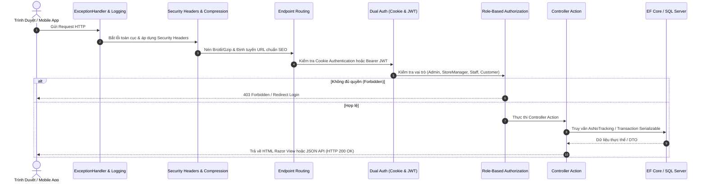

# 🏛️ TÀI LIỆU KIẾN TRÚC HỆ THỐNG (ARCHITECTURE SPECIFICATION)

> **Dự Án**: Perfume Luxe - Haute Parfumerie E-Commerce  
> **Kiến Trúc**: Clean Architecture (Onion / Hexagonal Architecture) kết hợp Domain-Driven Design (DDD)  
> **Nền Tảng**: Microsoft .NET 8.0 LTS  
> **Chuẩn Hóa Kỹ Thuật**: BMAD Framework - Pillar A (Architecture)  

---

## 1. Nguyên Tắc Thiết Kế Cốt Lõi (Core Principles)

Dự án tuân thủ nghiêm ngặt **Quy tắc phụ thuộc (Dependency Rule)** của Uncle Bob:
- **Tầng trong cùng (Domain)** không phụ thuộc vào bất kỳ tầng nào bên ngoài.
- **Tầng Ứng dụng (Application)** chỉ phụ thuộc vào Domain.
- **Tầng Hạ tầng (Infrastructure)** và **Tầng Trình diễn (Web)** phụ thuộc vào Application và Domain thông qua các Interface trừu tượng (Inversion of Control).

```text
                      +---------------------------------------+
                      |            Perfume.Web                |
                      |  - Controllers (MVC & API)            |
                      |  - Areas/Admin (Dashboard, DBConsole) |
                      |  - Views & Razor Components           |
                      |  - Security & Middleware Pipeline     |
                      +-------------------+-------------------+
                                          |
                                          v
+-----------------------------------------+-----------------------------------------+
|                          Perfume.Application                              |
|  - Interfaces / Contracts (IRepository, IEmailSender, IJwtService)                |
|  - DTOs, ViewModels & Request/Response Contracts                                  |
|  - Business Services & Domain Logic Orchestration                                 |
|  - Fragrance Recommendation AI Quiz Engine & Discovery Box                        |
+--------------------+------------------------------------+-------------------------+
                     ^                                    ^
                     |                                    |
+--------------------+-------------------+   +------------+-------------------------+
|        Perfume.Infrastructure          |   |            Perfume.Domain            |
|  - Entity Framework Core 8 DbContext   |   |  - Core Entities (Product, Order...) |
|  - Schema Upgrader Migrations V1 - V6  |   |  - Enums (OrderStatus, NoteLevel...) |
|  - Identity (AppUser, AppRole)         |   |  - Value Objects & Domain Rules      |
|  - In-Memory Caching & Redis Cache     |   |  - BaseEntity & Audit Properties     |
+----------------------------------------+   +--------------------------------------+
```

---

## 2. Chi Tiết Các Tầng Dự Án (Project Breakdown)

### 2.1. `Perfume.Domain` (Tầng Miền Nghiệp Vụ)
- **Vị trí**: `src/Perfume.Domain`
- **Trách nhiệm**: Chứa các thực thể cốt lõi, giá trị bất biến, định nghĩa Enum của ngành nước hoa. Hoàn toàn độc lập, không phụ thuộc vào bất kỳ thư viện bên ngoài hay EF Core nào.
- **Các thành phần chính**:
  - `BaseEntity`: Cung cấp `Id`, `CreatedAt`, `UpdatedAt`, `IsDeleted` (Soft Delete).
  - `Product`, `ProductVariant`, `ProductImage`, `ProductFragranceNote`: Cấu trúc dữ liệu sản phẩm đa dung tích (10ml, 50ml, 100ml) và kim tự tháp 3 tầng hương.
  - `Brand`, `Category`, `FragranceFamily`, `FragranceNote`: Cây phân loại nước hoa và nốt hương chuyên sâu.
  - `Order`, `OrderItem`: Quản lý quy trình vòng đời mua sắm, trạng thái đơn và thanh toán.
  - `Voucher`: Động cơ mã giảm giá, giới hạn ngân sách và thời hạn sử dụng.
  - `FlashSale`, `FlashSaleItem`: Quản lý chiến dịch giờ vàng có hạn mức số lượng bán.
  - `UserLoyalty`: Quản lý điểm thưởng tích lũy và 4 phân hạng VIP.
  - `ShoppingCart`, `ShoppingCartItem`: Giỏ hàng kép (Guest cookie SHA-256 + User account).
  - `Review`: Đánh giá của khách hàng kèm cơ chế kiểm duyệt trước khi hiển thị.
  - `BlogPost`: Tạp chí kiến thức khứu giác và bài viết chuẩn SEO.

### 2.2. `Perfume.Application` (Tầng Nghiệp Vụ Ứng Dụng)
- **Vị trí**: `src/Perfume.Application`
- **Trách nhiệm**: Xử lý các ca sử dụng (Use Cases), điều phối dữ liệu giữa tầng Domain và các dịch vụ bên ngoài.
- **Các dịch vụ tiêu biểu**:
  - `IPerfumeCatalogService`: Tra cứu danh mục, đa chiều faceted filters và AI Scent Quiz.
  - `ICustomerCartService`: Quản lý giỏ hàng kép, hợp nhất giỏ vãng lai và triệt tiêu N+1 Query.
  - `IOrderService`: Giao dịch thanh toán an toàn, trừ tồn kho nguyên tử cấp cơ sở dữ liệu.
  - `IFlashSaleService`: Kiểm soát thời hạn chiến dịch và tồn kho Flash Sale độc lập.
  - `ILoyaltyService`: Tự động tính toán chiết khấu VIP và thăng hạng thành viên.
  - `IDiscoveryBoxService`: Thẩm định cấu hình hộp quà, tính giá ống mẫu và in thiệp ép kim.

### 2.3. `Perfume.Infrastructure` (Tầng Hạ Tầng Kỹ Thuật)
- **Vị trí**: `src/Perfume.Infrastructure`
- **Trách nhiệm**: Triển khai các giao diện của Application, tương tác cơ sở dữ liệu, phân quyền bảo mật, cache và dịch vụ hệ thống.
- **Các thành phần cốt lõi**:
  - `PerfumeDbContext`: Ánh xạ Entity Framework Core 8 với cơ chế Interceptor tự động ghi nhận thời gian `CreatedAt` / `UpdatedAt` theo chuẩn UTC.
  - `DatabaseSchemaUpgrader`: Động cơ nâng cấp Schema tự động V1 đến V6 bên trong SQL Transaction có rollback.
  - `DatabaseConsoleService`: Công cụ quản trị CSDL trực quan phong cách AWS RDS Console.
  - `In-Memory Caching`: Cache các bảng taxonomy tĩnh trong bộ nhớ RAM máy chủ.

### 2.4. `Perfume.Web` (Tầng Trình Diễn & Giao Diện)
- **Vị trí**: `src/Perfume.Web`
- **Trách nhiệm**: Điểm khởi động ứng dụng (Host), tiếp nhận yêu cầu HTTP, xử lý xác thực/phân quyền, render giao diện người dùng và cung cấp Web API.

---

## 3. Quy Trình Xử Lý Yêu Cầu HTTP (Middleware Pipeline)



---

## 4. Cơ Chế Bảo Mật Kép (Dual Authentication)

Dự án hỗ trợ song song 2 cơ chế xác thực:
1. **Cookie-based Authentication**: Dành cho giao diện storefront & trang quản trị admin trên trình duyệt web (HttpOnly, SameSite=Lax, Secure).
2. **Bearer JWT Token Handler**: Dành cho các ứng dụng di động, đối tác hoặc Single Page Apps (`Authorization: Bearer <token>`).

---

## 5. Chiến Lược Tối Ưu Hóa Hiệu Năng (Performance Strategy)

1. **Triệt tiêu hoàn toàn truy vấn N+1**: Trong `CustomerCartService`, toàn bộ sản phẩm trong giỏ được gom danh sách ID và truy vấn bằng 1 câu lệnh duy nhất thay vì N truy vấn lặp trong vòng for.
2. **In-Memory Caching (`IMemoryCache`)**: Bảng tra cứu danh mục, thương hiệu, nhóm hương (`Brands`, `Categories`, `FragranceFamilies`, `FragranceNotes`) được cache trong RAM với thời gian 1 giờ, giải phóng hơn 80% tải đọc CSDL.
3. **Giao dịch đặt hàng Serializable**: Toàn bộ thao tác trừ tồn kho và đặt hàng được bọc trong giao dịch `IsolationLevel.Serializable` với lệnh trừ tồn kho nguyên tử (`ExecuteUpdateAsync`).
4. **Truy vấn chỉ đọc (`AsNoTracking`)**: Loại bỏ Change Tracker cho toàn bộ luồng đọc catalog và blog.
5. **Nén dữ liệu truyền tải**: Kích hoạt Brotli và Gzip nén HTTP Response ở tầng middleware.

---

> [!NOTE]
> Xem thêm tài liệu chi tiết phân rã kiến trúc chuẩn **BMAD Pillar A** tại [`docs/bmad/ARCHITECTURE.md`](./bmad/ARCHITECTURE.md).
