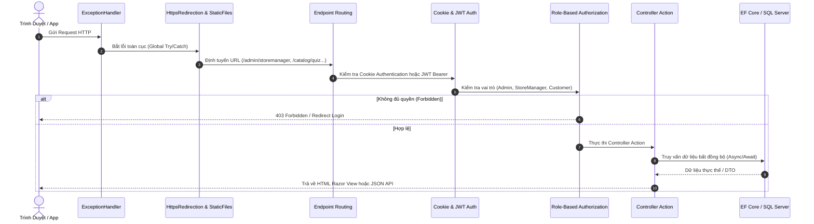

# 🏛️ TÀI LIỆU KIẾN TRÚC HỆ THỐNG (ARCHITECTURE SPECIFICATION)

> **Dự Án**: Perfume Luxe - Haute Parfumerie E-Commerce  
> **Kiến Trúc**: Clean Architecture (Onion / Hexagonal Architecture) kết hợp Domain-Driven Design (DDD)  
> **Nền Tảng**: Microsoft .NET 8.0 LTS

---

## 1. Nguyên Tắc Thiết Kế Cốt Lõi (Core Principles)

Dự án tuân thủ nghiêm ngặt **Quy tắc phụ thuộc (Dependency Rule)** của Uncle Bob:
- **Tầng trong cùng (Domain)** không phụ thuộc vào bất kỳ tầng nào bên ngoài.
- **Tầng Ứng dụng (Application)** chỉ phụ thuộc vào Domain.
- **Tầng Hạ tầng (Infrastructure)** và **Tầng Trình diễn (Web)** phụ thuộc vào Application và Domain thông qua các Interface trừu tượng (Inversion of Control).

```
                      +---------------------------------------+
                      |            Perfume.Web                |
                      |  - Controllers (MVC & API)            |
                      |  - Areas/Admin (Dashboard, DBConsole) |
                      |  - Views & Razor Components           |
                      |  - Security & Middleware Pipeline     |
                      +-------------------+-------------------+
                                          |
                                          v
+-----------------------------------------+-----------------------------------------+
|                          Perfume.Application                              |
|  - Interfaces / Contracts (IRepository, IEmailSender, IJwtService)                |
|  - DTOs, ViewModels & Request/Response Contracts                                  |
|  - Business Services & Domain Logic Orchestration                                 |
|  - Fragrance Recommendation AI Quiz Engine                                        |
+--------------------+------------------------------------+-------------------------+
                     ^                                    ^
                     |                                    |
+--------------------+-------------------+   +------------+-------------------------+
|        Perfume.Infrastructure          |   |            Perfume.Domain            |
|  - Entity Framework Core 8 DbContext   |   |  - Core Entities (Product, Order...) |
|  - Identity (AppUser, AppRole)         |   |  - Enums (OrderStatus, NoteLevel...) |
|  - Dapper (High-perf Analytics queries)|   |  - Value Objects & Domain Rules      |
|  - Redis Cache & System Settings       |   |  - BaseEntity & Audit Properties     |
+----------------------------------------+   +--------------------------------------+
```

---

## 2. Chi Tiết Các Tầng Dự Án (Project Breakdown)

### 2.1. `Perfume.Domain` (Tầng Miền Nghiệp Vụ)
- **Vị trí**: `src/Perfume.Domain`
- **Trách nhiệm**: Chứa các thực thể cốt lõi, giá trị bất biến, định nghĩa Enum của ngành nước hoa.
- **Các thành phần chính**:
  - `BaseEntity`: Cung cấp `Id`, `CreatedAt`, `UpdatedAt`, `IsDeleted` (Soft Delete).
  - `Product`, `ProductVariant`, `ProductImage`, `ProductFragranceNote`: Cấu trúc dữ liệu sản phẩm đa dung tích (10ml, 50ml, 100ml) và kim tự tháp 3 tầng hương.
  - `Brand`, `Category`, `FragranceFamily`, `FragranceNote`: Cây phân loại nước hoa và nốt hương chuyên sâu.
  - `Order`, `OrderItem`: Quản lý quy trình vòng đời mua sắm, trạng thái đơn và thanh toán.
  - `Voucher`: Động cơ mã giảm giá, giới hạn ngân sách và thời hạn sử dụng.
  - `Review`: Đánh giá của khách hàng kèm cơ chế kiểm duyệt trước khi hiển thị.
  - `BlogPost`: Tạp chí kiến thức khứu giác và bài viết chuẩn SEO.

### 2.2. `Perfume.Application` (Tầng Nghiệp Vụ Ứng Dụng)
- **Vị trí**: `src/Perfume.Application`
- **Trách nhiệm**: Xử lý các ca sử dụng (Use Cases), điều phối dữ liệu giữa tầng Domain và các dịch vụ bên ngoài, tính toán đề xuất mùi hương.
- **Các dịch vụ tiêu biểu**:
  - `IFreqQuizEngine`: Động cơ đối soát ma trận sở thích khách hàng với nhóm hương (Floral, Woody, Oriental, Fresh...) và nốt hương chủ đạo.
  - `IVoucherService`: Kiểm tra tính hợp lệ của mã giảm giá, số tiền tối thiểu, ngân sách tối đa và số lượt còn lại.
  - `ICartService`: Quản lý giỏ hàng cookie/session và tính toán tổng thanh toán thời gian thực.
  - `IBlogService`: Quản lý bài viết tạp chí, tự động sinh slug, thống kê lượt xem và bài liên quan.

### 2.3. `Perfume.Infrastructure` (Tầng Hạ Tầng Kỹ Thuật)
- **Vị trí**: `src/Perfume.Infrastructure`
- **Trách nhiệm**: Triển khai các giao diện của Application, tương tác cơ sở dữ liệu, phân quyền bảo mật, cache và dịch vụ hệ thống.
- **Các thành phần cốt lõi**:
  - `PerfumeDbContext`: Ánh xạ Entity Framework Core 8 với cơ chế Interceptor tự động ghi nhận thời gian `CreatedAt` / `UpdatedAt` theo chuẩn UTC.
  - `DatabaseConsoleService`: Công cụ quản trị CSDL trực quan phong cách AWS RDS Console (Table Explorer, Data Dictionary, Safe Query Runner, 1-Click Seeder).
  - `AppUser` & `AppRole`: Mở rộng ASP.NET Core Identity với các thuộc tính người dùng mở rộng (`FullName`, `AvatarUrl`, `TotalSpent`, `LoyaltyTier`).
  - `SystemSettingService`: Lưu trữ cấu hình runtime hệ thống trong bảng `SystemSettings` kèm bộ nhớ đệm in-memory / Redis.

### 2.4. `Perfume.Web` (Tầng Trình Diễn & Giao Diện)
- **Vị trí**: `src/Perfume.Web`
- **Trách nhiệm**: Điểm khởi động ứng dụng (Host), tiếp nhận yêu cầu HTTP, xử lý xác thực/phân quyền, render giao diện người dùng và cung cấp Web API.
- **Hai phân hệ chính**:
  1. **Storefront (Khách hàng)**: Giao diện xa xỉ Haute Parfumerie Dark/Light theme, tối ưu hóa tốc độ tải trang, trải nghiệm mua sắm mượt mà không reload trang.
  2. **Areas/Admin (Ban Quản Trị & Cửa Hàng Trưởng)**:
     - `AdminDashboard`: Trung tâm điều hành vĩ mô (Doanh thu sàn, Tỷ lệ đơn hàng, Biểu đồ Chart.js, Phân quyền người dùng, Quản trị bài viết, Sơ đồ ERD).
     - `StoreManager`: Bảng điều khiển vận hành bán lẻ độc quyền (Dòng tiền ca COD/Online, Tồn kho cảnh báo đứt hàng, Hiệu suất voucher, Top khách hàng VIP).
     - `DatabaseConsole`: Quản trị CSDL trực quan cấp hệ thống.

---

## 3. Quy Trình Xử Lý Yêu Cầu HTTP (Middleware Pipeline)



---

## 4. Các Design Patterns Ứng Dụng

1. **Repository & Unit of Work (via EF Core)**: Đảm bảo tính toàn vẹn giao dịch ACID khi thực hiện đơn hàng phức tạp.
2. **Dependency Injection (IoC)**: Tách biệt hoàn toàn việc khởi tạo đối tượng, dễ dàng viết Unit Test và tích hợp kiểm thử đối kháng.
3. **Data Transfer Object (DTO)**: Bảo vệ cấu trúc thực thể Domain nội bộ, chỉ phơi bày các thuộc tính cần thiết ra giao diện hoặc API.
4. **Options Pattern**: Cấu hình các thiết lập bảo mật, chuỗi kết nối và JWT thông qua `IOptionsSnapshot<T>`.
5. **View Component & Partial Views**: Tái sử dụng các thành phần giao diện phức tạp như Khối 3 Tầng Hương, Thẻ Sản Phẩm Luxury, Mini-Cart Drawer.
