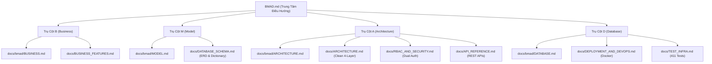

# PERFUME LUXE — TÀI LIỆU BMAD TOÀN DIỆN DỰ ÁN (BMAD SPECIFICATION)

> **Dự án:** Perfume Luxe — Nền Tảng Thương Mại Điện Tử Nước Hoa Cao Cấp & Niche Haute Parfumerie  
> **Kiến trúc:** Clean / Onion Architecture (.NET 8 MVC + REST APIs + EF Core + SQL Server)  
> **Bộ kiểm thử:** 411 Unit & Integration Tests (100% Passed)  
> **Tiêu chuẩn tài liệu:** BMAD Framework (**B**usiness — **M**odel — **A**rchitecture — **D**atabase & Deployment)  
> **Bộ hồ sơ chi tiết:** Tích hợp trọn vẹn trong thư mục [`docs/`](./README.md) và [`docs/bmad/`](./bmad/README.md)  

---

## 🗺️ BẢN ĐỒ TÍCH HỢP TÀI LIỆU BMAD & TÀI LIỆU KỸ THUẬT HIỆN CÓ

Hệ thống tài liệu được tích hợp đa chiều giữa các đặc tả chuẩn **BMAD Framework** và bộ tài liệu kỹ thuật chuyên sâu hiện có của dự án:

---

## 🧭 CHI TIẾT 4 TRỤ CỘT BMAD ĐƯỢC TÍCH HỢP

### 1. Trụ Cột B: Business & Nghiệp Vụ
- **Hồ sơ BMAD**: [`docs/bmad/BUSINESS.md`](./bmad/BUSINESS.md)
- **Tài liệu chi tiết**: [`docs/BUSINESS_FEATURES.md`](./BUSINESS_FEATURES.md)
- **Nội dung tích hợp**:
  - Bối cảnh thị trường Niche Haute Parfumerie & 3 Persona khách hàng.
  - Luồng hành trình khách hàng (Customer Journeys).
  - 6 tính năng độc bản: Trắc nghiệm AI Scent Quiz, Hộp quà cá nhân hóa Discovery Box, Flash Sale giờ vàng đếm ngược, Hạng thẻ VIP Loyalty 4 cấp (Bronze, Silver, Gold, Diamond), Giỏ hàng kép (Dual Cart), và Tra cứu vận đơn realtime không cần đăng nhập.

### 2. Trụ Cột M: Model & Thực Thể Dữ Liệu
- **Hồ sơ BMAD**: [`docs/bmad/MODEL.md`](./bmad/MODEL.md)
- **Tài liệu chi tiết**: [`docs/DATABASE_SCHEMA.md`](./DATABASE_SCHEMA.md)
- **Nội dung tích hợp**:
  - Sơ đồ thực thể quan hệ Mermaid ERD mở rộng.
  - Danh mục 22 bảng CSDL từ điển dữ liệu (Product, Variant, Note, Order, FlashSale, Loyalty, Cart, StockAdjustment...).
  - Hệ thống Enums: Nồng độ tinh dầu (`Concentration`), Giới tính (`GenderTarget`), Tầng hương (`NoteLevel`), Trạng thái đơn (`OrderStatus`), Thanh toán (`PaymentStatus`, `PaymentMethod`), Phân hạng VIP (`UserTier`).

### 3. Trụ Cột A: Architecture & Kiến Trúc Hệ Thống
- **Hồ sơ BMAD**: [`docs/bmad/ARCHITECTURE.md`](./bmad/ARCHITECTURE.md)
- **Tài liệu chi tiết**: [`docs/ARCHITECTURE.md`](./ARCHITECTURE.md), [`docs/RBAC_AND_SECURITY.md`](./RBAC_AND_SECURITY.md), [`docs/API_REFERENCE.md`](./API_REFERENCE.md)
- **Nội dung tích hợp**:
  - Clean Architecture 4 tầng (Domain → Application → Infrastructure → Web).
  - Sequence Diagram quy trình Request-Response và đặt hàng giao dịch an toàn cấp `IsolationLevel.Serializable`.
  - Cơ chế bảo mật kép Dual Authentication: Cookie-based (Web Storefront/Admin) và Bearer JWT Tokens (REST APIs).
  - Chiến lược tối ưu hóa hiệu năng: Triệt tiêu N+1 Query (Batch Loading), In-Memory Caching (`IMemoryCache`) các bảng taxonomy tĩnh, và nén dữ liệu Brotli/Gzip.

### 4. Trụ Cột D: Database & Triển Khai Vận Hành
- **Hồ sơ BMAD**: [`docs/bmad/DATABASE.md`](./bmad/DATABASE.md)
- **Tài liệu chi tiết**: [`docs/DATABASE_SCHEMA.md`](./DATABASE_SCHEMA.md), [`docs/DEPLOYMENT_AND_DEVOPS.md`](./DEPLOYMENT_AND_DEVOPS.md), [`docs/TEST_INFRA.md`](./TEST_INFRA.md), [`docs/STORE_MANAGER_AND_ADMIN_GUIDE.md`](./STORE_MANAGER_AND_ADMIN_GUIDE.md)
- **Nội dung tích hợp**:
  - Động cơ nâng cấp Schema tự động `DatabaseSchemaUpgrader` quản lý Migration V1 đến V6 bên trong SQL Transaction an toàn có rollback.
  - Hệ thống chỉ mục B-Tree Indexing hiệu năng cao (V6) trên các cột truy vấn chính.
  - Container hóa Docker & Docker Compose sẵn sàng môi trường Production.
  - Bộ kiểm thử tự động 411 Unit & Integration Tests đạt tỷ lệ 100% Pass.

---

## 📋 CÁC QUY CHUẨN KỸ THUẬT BỔ TRỢ

- **[Phân Rã Epics & User Stories (`docs/bmad/EPICS_AND_STORIES.md`)](./bmad/EPICS_AND_STORIES.md)**: Danh mục 8 Epics (EPC-01 đến EPC-08) và Definition of Done (DoD).
- **[Quy Chuẩn Code & Chú Thích (`docs/bmad/CODING_STANDARDS.md`)](./bmad/CODING_STANDARDS.md)**: Hướng dẫn Clean Code, SOLID, và quy định bắt buộc comment tiếng Việt không dấu (`tieng viet khong dau`).
- **[Ngăn Xếp Kỹ Thuật (`docs/bmad/TECH_STACK.md`)](./bmad/TECH_STACK.md)**: Bảng thông số kỹ thuật .NET 8 LTS, EF Core 8, SQL Server 2022, Caching In-Memory, xUnit và Moq.
