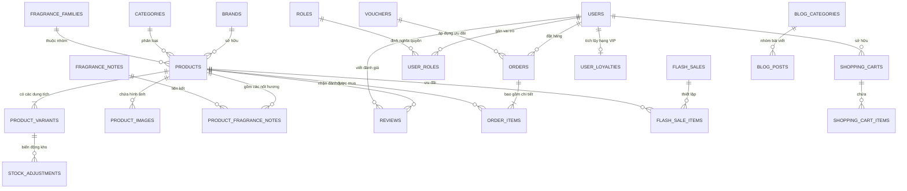

# 🗄️ TÀI LIỆU CƠ SỞ DỮ LIỆU (DATABASE SCHEMA & DATA DICTIONARY)

> **Cơ sở dữ liệu**: Microsoft SQL Server 2022 (Linux Container / Localhost)  
> **Database Name**: `PerfumeDb`  
> **Bộ mã hóa (Collation)**: `SQL_Latin1_General_CP1_CI_AS` (Hỗ trợ tiếng Việt Unicode chuẩn UTF-8 qua `NVARCHAR`)  
> **Chuẩn Hóa Kỹ Thuật**: BMAD Framework - Pillar D (Database)  

---

## 1. Sơ Đồ Thực Thể Quan Hệ Mở Rộng (ERD Diagram)

---

## 2. Danh Mục Các Bảng CSDL Mở Rộng (Data Dictionary)

### 2.1. Nhóm Bảng Danh Mục Sản Phẩm (Catalog Domain)
1. **`Brands`**: Thương hiệu nước hoa (`Id`, `Name`, `Slug`, `Country`, `Description`, `LogoUrl`, `IsFeatured`).
2. **`Categories`**: Phân loại danh mục (`Id`, `Name`, `Slug`, `Description`, `DisplayOrder`).
3. **`FragranceFamilies`**: Nhóm hương chủ đạo (`Id`, `Name`, `Slug`, `ColorHex`, `ScentType`, `Description`).
4. **`FragranceNotes`**: Nốt hương chi tiết (`Id`, `Name`, `Slug`, `Description`).
5. **`Products`**: Nước hoa cốt lõi (`Id`, `Name`, `Slug`, `Sku`, `BasePrice`, `Concentration`, `Gender`, `Longevity`, `Sillage`, `RatingAverage`, `RatingCount`, `IsInStock`, `IsFeatured`, `IsBestSeller`, `IsNewArrival`).
6. **`ProductVariants`**: Phiên bản dung tích (`Id`, `ProductId`, `VolumeMl`, `VolumeLabel`, `VariantSku`, `OriginalPrice`, `SalePrice`, `StockQuantity`, `IsDefault`).
7. **`ProductImages`**: Thư viện ảnh sản phẩm (`Id`, `ProductId`, `ImageUrl`, `DisplayOrder`, `IsMain`).
8. **`ProductFragranceNotes`**: Bảng liên kết 3 tầng hương (`ProductId`, `FragranceNoteId`, `NoteLevel`: Top, Heart, Base).

### 2.2. Nhóm Bảng Đơn Hàng & Mua Sắm (Commerce Domain)
9. **`Orders`**: Đơn đặt hàng (`Id`, `OrderCode`, `UserId`, `CustomerName`, `CustomerPhone`, `CustomerEmail`, `ShippingAddress`, `SubTotal`, `DiscountAmount`, `LoyaltyDiscountAmount`, `ShippingFee`, `GiftWrappingFee`, `TotalAmount`, `PaymentMethod`, `PaymentStatus`, `OrderStatus`, `AppliedLoyaltyTier`, `GiftMessage`, `CreatedAt`).
10. **`OrderItems`**: Chi tiết sản phẩm trong đơn (`Id`, `OrderId`, `ProductId`, `VariantId`, `ProductName`, `VariantLabel`, `UnitPrice`, `Quantity`, `IsCustomBox`, `CustomBoxConfigJson`).
11. **`ShoppingCarts`**: Giỏ hàng lưu trữ (`Id`, `OwnerKey`, `UserId`, `ExpiresAt`).
12. **`ShoppingCartItems`**: Món hàng trong giỏ (`Id`, `ShoppingCartId`, `ProductId`, `VariantId`, `Quantity`, `CustomUnitPrice`, `IsCustomBox`, `CustomBoxConfigJson`).
13. **`Vouchers`**: Mã ưu đãi (`Id`, `Code`, `DiscountPercent`, `DiscountAmount`, `MinOrderAmount`, `MaxDiscountAmount`, `UsageLimit`, `UsedCount`, `ValidFrom`, `ValidTo`, `IsActive`).

### 2.3. Nhóm Bảng Tính Năng Độc Bản (Signature Features)
14. **`FlashSales`**: Chiến dịch giờ vàng (`Id`, `Name`, `Description`, `StartTime`, `EndTime`, `IsActive`, `BannerUrl`).
15. **`FlashSaleItems`**: Suất mua Flash Sale (`Id`, `FlashSaleId`, `ProductId`, `VariantId`, `FlashSalePrice`, `StockLimit`, `SoldQuantity`).
16. **`UserLoyalties`**: Hồ sơ VIP tích điểm (`Id`, `UserId`, `Tier`, `Points`, `TotalSpent`).
17. **`StockAdjustments`**: Lịch sử điều chỉnh tồn kho & giá vốn COGS (`Id`, `VariantId`, `OldQuantity`, `AdjustedQuantity`, `NewQuantity`, `UnitCost`, `Reason`, `PerformedByName`).

### 2.4. Nhóm Bảng Quản Trị & Nội Dung (Admin & Editorial)
18. **`BlogCategories`** & **`BlogPosts`**: Tạp chí mùi hương chuẩn SEO.
19. **`Reviews`**: Đánh giá nhận xét có kiểm duyệt.
20. **`Users`**, **`Roles`**, **`UserRoles`**: Phân quyền RBAC Identity.
21. **`SystemSettings`**, **`HeroBanners`**: Cấu hình giao diện và hoạt động thời gian thực.
22. **`DatabaseAuditLogs`**, **`SystemErrorLogs`**: Nhật ký kiểm toán bảo mật và log lỗi hệ thống.

---

## 3. Động Cơ Nâng Cấp Schema (Migration Engine V1 - V6)

Hệ thống quản lý phiên bản CSDL tự động qua `DatabaseSchemaUpgrader`:

| Bản Migration | Tên Phiên Bản | Mục Đích Cập Nhật Schema |
|---|---|---|
| **V1** | `20261015_01_add_cart_audit_tokens` | Tạo bảng Giỏ hàng, Audit Log, Refresh Tokens. |
| **V2** | `20261015_02_add_store_settings_banners_stock` | Tạo bảng SystemSettings, HeroBanners, StockAdjustments. |
| **V3** | `20261015_03_add_flash_sale_and_loyalty` | Tạo bảng FlashSales, FlashSaleItems, UserLoyalties. |
| **V4** | `20261015_04_add_error_logs` | Tạo bảng SystemErrorLogs ghi log lỗi toàn cục. |
| **V5** | `20261015_05_seed_ai_radar_seo_blog_posts` | Nạp 12 bài viết blog tạp chí chuẩn SEO tự động. |
| **V6** | `20261029_06_add_performance_indexes` | Hệ thống đánh chỉ mục B-Tree Indexing hiệu năng cao. |

---

## 4. Hệ Thống Chỉ Mục Hiệu Năng Cao (B-Tree Indexes - V6)

| Tên Chỉ Mục | Bảng | Cột Đánh Index | Tối Ưu Truy Vấn |
|---|---|---|---|
| `IX_Products_CreatedAt` | `Products` | `CreatedAt DESC` | Sắp xếp sản phẩm mới nhất mặc định tại catalog & trang chủ. |
| `IX_Products_BasePrice` | `Products` | `BasePrice` | Lọc khoảng giá `MinPrice - MaxPrice` và sắp xếp giá tăng/giảm. |
| `IX_Products_IsFeatured_CreatedAt` | `Products` | `IsFeatured, CreatedAt DESC` | Tải ngay 8 sản phẩm nổi bật trang chủ không cần quét bảng. |
| `IX_Products_IsBestSeller_CreatedAt` | `Products` | `IsBestSeller, CreatedAt DESC`| Tải nhanh danh sách sản phẩm bán chạy nhất. |
| `IX_Products_IsNewArrival_CreatedAt` | `Products` | `IsNewArrival, CreatedAt DESC` | Tải nhanh bộ sưu tập hàng mới về. |
| `IX_Orders_UserId_CreatedAt` | `Orders` | `UserId, CreatedAt DESC` | Xem lịch sử đơn hàng của người dùng realtime. |
| `IX_Orders_OrderStatus_CreatedAt` | `Orders` | `OrderStatus, CreatedAt DESC` | Quản trị viên lọc đơn hàng theo trạng thái. |
| `IX_OrderItems_OrderId` | `OrderItems` | `OrderId` | Tải chi tiết các món hàng theo mã đơn trong 1 round-trip. |

---

## 5. Kịch Bản Khởi Tạo Dữ Liệu Tinh Gọn (Data Seeding)

Thư mục [`scripts/`](../scripts/) được tổ chức tinh gọn:
- **`seed_perfume_data.sql`**: Kịch bản nạp dữ liệu cốt lõi (15+ chai nước hoa, thương hiệu, nhóm hương, voucher) kết nối trực tiếp với tính năng **1-Click Seeder** trên Web Admin.
- **`seed_extended_data.sql`**: Kịch bản mở rộng hoàn chỉnh (sản phẩm, đơn hàng, đánh giá, banner) dùng chạy thủ công qua SSMS / Docker.

---

> [!NOTE]
> Xem thêm tài liệu chi tiết mô hình thực thể chuẩn **BMAD Pillar D & M** tại [`docs/bmad/DATABASE.md`](./bmad/DATABASE.md) và [`docs/bmad/MODEL.md`](./bmad/MODEL.md).
