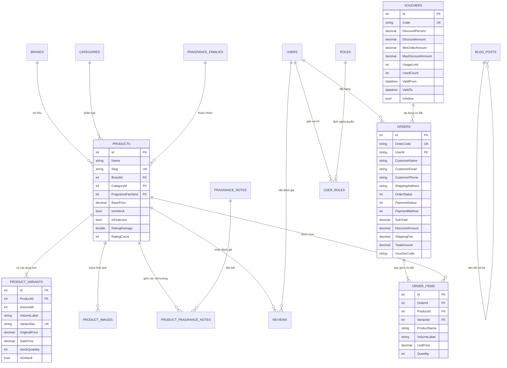

# 🗄️ TÀI LIỆU CƠ SỞ DỮ LIỆU (DATABASE SCHEMA & DATA DICTIONARY)

> **Cơ sở dữ liệu**: Microsoft SQL Server 2022 (Linux Container / Localhost)  
> **Database Name**: `PerfumeDb`  
> **Bộ mã hóa (Collation)**: `SQL_Latin1_General_CP1_CI_AS` (Hỗ trợ tiếng Việt Unicode chuẩn UTF-8 qua `NVARCHAR`)

---

## 1. Sơ Đồ Thực Thể Quan Hệ (Entity Relationship Diagram - ERD)

---

## 2. Từ Điển Dữ Liệu (Data Dictionary - 17 Bảng Cốt Lõi)

### 2.1. Nhóm Bảng Danh Mục Sản Phẩm (Catalog Entities)
1. **`Brands`**: Quản lý thương hiệu nước hoa danh tiếng (Chanel, Dior, Tom Ford, Creed, Le Labo, Maison Margiela, Byredo, Kilian...).
   - `Id` (INT, PK), `Name` (NVARCHAR(150)), `Slug` (VARCHAR(150), Unique), `Description` (NVARCHAR(MAX)), `LogoUrl` (NVARCHAR(500)), `CountryOfOrigin` (NVARCHAR(100)), `IsFeatured` (BIT).
2. **`Categories`**: Phân loại danh mục (Nước Hoa Nam, Nước Hoa Nữ, Nước Hoa Unisex, Niche Discovery Sets, Body Mist & Scented Oil).
   - `Id` (INT, PK), `Name` (NVARCHAR(100)), `Slug` (VARCHAR(120), Unique), `DisplayOrder` (INT).
3. **`FragranceFamilies`**: Nhóm hương khứu giác chuẩn quốc tế (Woody/Gỗ, Floral/Hoa cỏ, Oriental/Hổ phách phương Đông, Fresh/Tươi mát, Citrus/Cam chanh, Gourmand/Ngọt ngào).
   - `Id` (INT, PK), `Name` (NVARCHAR(100)), `Description` (NVARCHAR(MAX)), `IconClass` (VARCHAR(80)), `ColorHex` (VARCHAR(20)).
4. **`FragranceNotes`**: Từ điển các nốt hương thành phần (Bergamot, Tiêu hồng, Hoa hồng Thổ Nhĩ Kỳ, Trầm hương Agarwood, Vani Bourbon...).
   - `Id` (INT, PK), `Name` (NVARCHAR(100)), `Description` (NVARCHAR(MAX)), `ImageUrl` (NVARCHAR(500)).
5. **`Products`**: Bản ghi sản phẩm chính mang tính định danh.
   - `Id` (INT, PK), `Name` (NVARCHAR(200)), `Slug` (VARCHAR(250), Unique), `BrandId` (INT, FK), `CategoryId` (INT, FK), `FragranceFamilyId` (INT, FK), `Concentration` (INT, Enum: Extrait, EDP, EDT, EDC), `BasePrice` (DECIMAL(18,2)), `IsInStock` (BIT), `IsFeatured` (BIT), `RatingAverage` (FLOAT), `RatingCount` (INT).
6. **`ProductVariants`**: Phiên bản dung tích thực tế phục vụ mua hàng và kiểm kho.
   - `Id` (INT, PK), `ProductId` (INT, FK), `VolumeMl` (INT), `VolumeLabel` (NVARCHAR(80)), `VariantSku` (VARCHAR(80), Unique), `OriginalPrice` (DECIMAL(18,2)), `SalePrice` (DECIMAL(18,2)), `StockQuantity` (INT), `IsDefault` (BIT).
7. **`ProductImages`**: Thư viện hình ảnh sản phẩm góc chụp nghệ thuật.
   - `Id` (INT, PK), `ProductId` (INT, FK), `ImageUrl` (NVARCHAR(500)), `IsPrimary` (BIT), `DisplayOrder` (INT).
8. **`ProductFragranceNotes`**: Bảng liên kết ánh xạ kim tự tháp 3 tầng hương.
   - `Id` (INT, PK), `ProductId` (INT, FK), `FragranceNoteId` (INT, FK), `NoteLevel` (INT, Enum: 1=Top, 2=Heart/Middle, 3=Base), `DisplayOrder` (INT).

### 2.2. Nhóm Bảng Mua Hàng & Khuyến Mãi (Orders & Promotions)
9. **`Orders`**: Đơn đặt hàng từ khách hàng.
   - `Id` (INT, PK), `OrderCode` (VARCHAR(40), Unique), `UserId` (NVARCHAR(450), FK nullable), `CustomerName` (NVARCHAR(150)), `CustomerEmail` (NVARCHAR(200)), `CustomerPhone` (NVARCHAR(30)), `ShippingAddress` (NVARCHAR(500)), `OrderStatus` (INT: Pending=0, Confirmed=1, Shipping=2, Delivered=3, Cancelled=4), `PaymentStatus` (INT: Unpaid=0, Pending=1, Completed=2, Failed=3), `PaymentMethod` (INT: COD=1, VNPAY=2, BankTransfer=3, MoMo=4), `SubTotal` (DECIMAL(18,2)), `DiscountAmount` (DECIMAL(18,2)), `ShippingFee` (DECIMAL(18,2)), `TotalAmount` (DECIMAL(18,2)), `VoucherCode` (NVARCHAR(50)).
10. **`OrderItems`**: Chi tiết từng chai nước hoa trong đơn hàng (lưu snapshot thông tin tại thời điểm mua).
    - `Id` (INT, PK), `OrderId` (INT, FK), `ProductId` (INT, FK), `VariantId` (INT, FK), `ProductName` (NVARCHAR(200)), `VolumeLabel` (NVARCHAR(80)), `ProductImageUrl` (NVARCHAR(500)), `UnitPrice` (DECIMAL(18,2)), `Quantity` (INT).
11. **`Vouchers`**: Mã giảm giá kích cầu mua sắm.
    - `Id` (INT, PK), `Code` (VARCHAR(40), Unique), `Description` (NVARCHAR(300)), `DiscountPercent` (DECIMAL(5,2)), `DiscountAmount` (DECIMAL(18,2)), `MinOrderAmount` (DECIMAL(18,2)), `MaxDiscountAmount` (DECIMAL(18,2)), `UsageLimit` (INT), `UsedCount` (INT), `ValidFrom` (DATETIME2), `ValidTo` (DATETIME2), `IsActive` (BIT).

### 2.3. Nhóm Bảng Tương Tác & Nội Dung (Reviews & Editorial Blog)
12. **`Reviews`**: Nhận xét và chấm điểm sao của khách hàng.
    - `Id` (INT, PK), `ProductId` (INT, FK), `UserId` (NVARCHAR(450), FK), `Rating` (INT: 1-5), `Title` (NVARCHAR(200)), `Comment` (NVARCHAR(MAX)), `IsApproved` (BIT - Phải được StoreManager/Admin duyệt trước khi hiển thị công khai), `IsVerifiedBuyer` (BIT).
13. **`BlogPosts`**: Tạp chí Haute Parfumerie và bài viết giáo dục khứu giác.
    - `Id` (INT, PK), `Title` (NVARCHAR(250)), `Slug` (VARCHAR(300), Unique), `Summary` (NVARCHAR(500)), `Content` (NVARCHAR(MAX)), `ThumbnailUrl` (NVARCHAR(500)), `AuthorName` (NVARCHAR(100)), `ViewCount` (INT), `IsPublished` (BIT), `PublishedAt` (DATETIME2), `Tags` (NVARCHAR(300)).

### 2.4. Nhóm Bảng Quản Trị Hệ Thống & Identity (Security & Infra)
14. **`AspNetUsers` / `AppUser`**: Tài khoản người dùng hệ thống.
    - `Id`, `UserName`, `Email`, `FullName`, `PhoneNumber`, `CreatedAt`, `LastLoginAt`, `TotalSpent`, `LoyaltyTier`.
15. **`AspNetRoles` / `AppRole`**: Vai trò bảo mật (`Admin`, `StoreManager`, `Customer`).
16. **`AspNetUserRoles`**: Bảng liên kết N-N gán vai trò cho người dùng.
17. **`SystemSettings`**: Tham số cấu hình hoạt động thời gian thực (Key/Value/Category).

---

## 3. Chỉ Mục Tối Ưu Hiệu Năng (Database Indexes)

Các chỉ mục quan trọng đã được cấu hình trong `PerfumeDbContext`:
- `IX_Products_Slug`: Tìm kiếm sản phẩm theo đường dẫn thân thiện URL (`UNIQUE NONCLUSTERED`).
- `IX_Products_BrandId` & `IX_Products_FragranceFamilyId`: Tăng tốc độ lọc danh mục và bộ lọc nước hoa.
- `IX_Orders_OrderCode`: Truy vết đơn hàng tức thì bằng mã tra cứu (`UNIQUE NONCLUSTERED`).
- `IX_Orders_CreatedAt_OrderStatus`: Tối ưu hóa truy vấn tính toán thống kê và biểu đồ Dashboard.
- `IX_ProductVariants_StockQuantity`: Tối ưu cảnh báo tồn kho thấp (Low Stock) và cháy hàng (Out of Stock).
- `IX_BlogPosts_Slug_IsPublished`: Tải bài viết tạp chí theo URL công khai.

---

## 4. Kịch Bản Khởi Tạo Dữ Liệu (Data Seeding)

- Dữ liệu hoàn chỉnh được nạp từ script [scripts/seed_perfume_data.sql](file:///c:/Users/Sieu%20Chu%20nhiem/Desktop/dotnet/scripts/seed_perfume_data.sql).
- Hỗ trợ **1-Click Seeder** trực tiếp từ trang Admin Database Console (`/admin/databaseconsole`) mà không cần mở công cụ dòng lệnh hay SSMS.
- Script tự động kiểm tra `IF NOT EXISTS` và cập nhật dữ liệu một cách an toàn (Idempotent).
