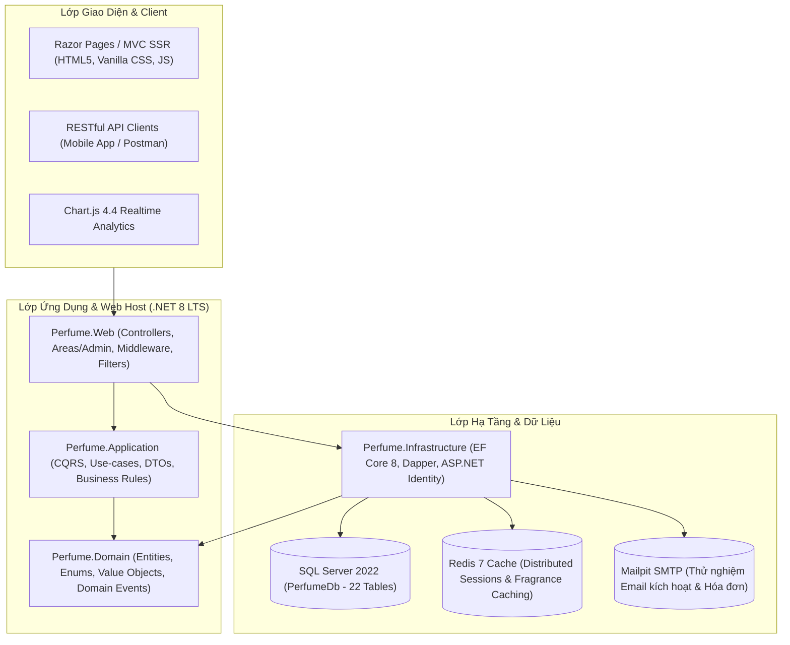

# 📚 PERFUME LUXE - ENTERPRISE DOCUMENTATION SUITE

> **Bộ Tài Liệu Kỹ Thuật & Vận Hành Toàn Diện Cho Nền Tảng Thương Mại Điện Tử Haute Parfumerie**  
> Phiên bản hệ thống: **v1.2.0-LTS** | Nền tảng: **.NET 8.0 LTS (C# 12)** | CSDL: **Microsoft SQL Server 2022 & Redis 7**

---

## 🧭 1. Bản Đồ Điều Hướng Tài Liệu (Documentation Sitemap)

Hệ thống tài liệu được tổ chức theo chuẩn kiến trúc cấp tập đoàn (Enterprise Grade), phân định rõ ràng giữa các khía cạnh Kỹ thuật, Dữ liệu, Bảo mật, Nghiệp vụ và Vận hành:

| Tài Liệu | Nội Dung Cốt Lõi | Đối Tượng Mục Tiêu |
| :--- | :--- | :--- |
| 📘 [**BMAD.md**](./BMAD.md) | **Tài liệu chuẩn BMAD (Business - Model - Architecture - Database) & Hồ sơ [docs/bmad/](./bmad/README.md)** | Toàn bộ các bên liên quan (C-Level, PM, Architects, Devs) |
| 🏛️ [**ARCHITECTURE.md**](./ARCHITECTURE.md) | Kiến trúc Clean Architecture 4 Tầng, Design Patterns, C4 Model, Middleware Pipeline | Solution Architects, Senior Engineers |
| 🗄️ [**DATABASE_SCHEMA.md**](./DATABASE_SCHEMA.md) | 22 Bảng CSDL, Sơ đồ ERD Mermaid, Data Dictionary, Schema Migration V1-V6, Indexing & Audit | Database Administrators, Backend Devs |
| 🛡️ [**RBAC_AND_SECURITY.md**](./RBAC_AND_SECURITY.md) | Ma trận phân quyền 3 cấp (Admin, StoreManager, Customer), JWT & Identity Cookie, OWASP Hardening | Security Officers, Lead Developers |
| 💎 [**BUSINESS_FEATURES.md**](./BUSINESS_FEATURES.md) | Đặc tả 10 Nghiệp vụ cốt lõi: Catalog 3 Tầng Hương, AI Quiz, Cart, Checkout, Blog, Discovery Box, VIP Loyalty, Flash Sale, VietQR, Order Tracking | Product Managers, Business Analysts |
| 📊 [**STORE_MANAGER_AND_ADMIN_GUIDE.md**](./STORE_MANAGER_AND_ADMIN_GUIDE.md) | Sổ tay vận hành Dashboard: Phân tích dòng tiền ca, Tốc độ xoay vòng kho, Báo cáo tồn kho, Quản lý Voucher | Store Managers, C-Level, Operations |
| 🔌 [**API_REFERENCE.md**](./API_REFERENCE.md) | Đặc tả RESTful Web API cho Mobile App/Frontend SPA, Customer API, JWT Bearer Auth | Frontend/Mobile Devs, Integrators |
| 🚀 [**DEPLOYMENT_AND_DEVOPS.md**](./DEPLOYMENT_AND_DEVOPS.md) | Triển khai Docker, Docker Compose, Quản lý biến môi trường `.env`, Database Migrations & Backup | DevOps, SRE, SysAdmins |

---

## 🛠️ 2. Công Nghệ Chủ Đạo (Core Technology Stack)



- **Framework**: .NET 8.0 (C# 12) Web Application
- **Kiến trúc**: Domain-Driven Design (DDD) & Clean Architecture
- **ORM / Data Access**: Entity Framework Core 8.0 & Dapper Micro-ORM
- **Cơ sở dữ liệu**: Microsoft SQL Server 2022 (Linux Container)
- **Caching**: Redis Server 7.x (Distributed Cache)
- **Thư viện giao diện**: Vanilla CSS cao cấp Haute Parfumerie, Font Awesome 6.5, Chart.js 4.4, Bootstrap Grid tối giản
- **Containerization**: Docker Multi-stage build & Docker Compose kép (`infra` cho Dev, `full` cho Prod)

---

## ⚡ 3. Hướng Dẫn Khởi Động Nhanh (Quick Start)

### Bước 1: Khởi động cơ sở dữ liệu hạ tầng
```powershell
# Chạy SQL Server, Redis và Mailpit ngầm
docker compose -f docker-compose.infra.yml up -d
```

### Bước 2: Nạp dữ liệu Seeder ban đầu (15+ chai nước hoa kinh điển & 12 bài viết Tạp chí)
Mở ứng dụng hoặc sử dụng script SQL:
```powershell
# Thực thi nạp dữ liệu độc lập
sqlcmd -S localhost,1433 -U sa -P "YourStrong@Password123" -i scripts/seed_perfume_data.sql
```

### Bước 3: Chạy Web Application
```powershell
dotnet watch --project src/Perfume.Web run
```
Truy cập:
- Cửa hàng (Storefront): `http://localhost:5000`
- Trắc nghiệm mùi hương AI: `http://localhost:5000/catalog/quiz`
- Tạp chí Haute Parfumerie: `http://localhost:5000/blog`
- Bảng điều khiển Quản lý Cửa hàng: `http://localhost:5000/admin/storemanager`
- Tổng quan Quản trị Tối cao: `http://localhost:5000/admin/admindashboard`
- AWS-style Database Console: `http://localhost:5000/admin/databaseconsole`
