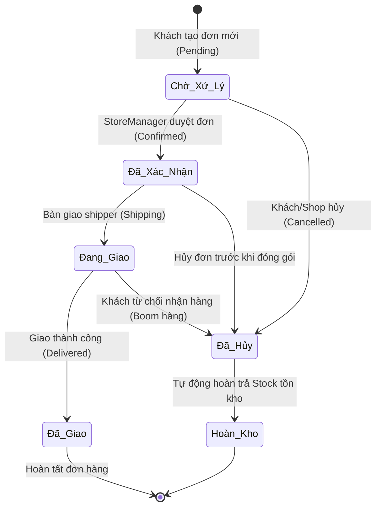

# 📊 SỔ TAY VẬN HÀNH DÀNH CHO CỬA HÀNG TRƯỞNG & QUẢN TRỊ VIÊN
# (STORE MANAGER & ADMIN OPERATIONAL MANUAL)

> **Mục Đích**: Hướng dẫn khai thác tối đa hệ thống Business Intelligence Suite, quản lý dòng tiền ca bán lẻ, phòng ngừa nguy cơ đứt hàng tồn kho và điều hành đơn hàng trơn tru.

---

## 1. Trung Tâm Phân Tích Vận Hành Cửa Hàng (`/admin/storemanager`)

Giao diện độc quyền được thiết kế dành riêng cho vai trò **Cửa Hàng Trưởng (StoreManager)** và **Quản Trị Viên Cấp Cao (Admin)**:

### 1.1. Bộ 6 Chỉ Số KPI Bán Lẻ Thực Chiến

| Chỉ Số KPI | Ý Nghĩa Nghiệp Vụ | Hành Động Quản Trị Cần Thực Hiện |
| :--- | :--- | :--- |
| **Doanh Thu Thực Thu** | Tổng giá trị tiền mặt và chuyển khoản của các đơn đã giao thành công (`Delivered` & `Paid`). | Đối chiếu với sao kê tài khoản ngân hàng và phiếu nộp tiền mặt của shipper. |
| **AOV (Đơn Trung Bình)** | `Doanh Thu / Số Đơn Hoàn Tất`. Thước đo sức chi trả của khách hàng trong kỳ. | Nếu AOV giảm, cần tung combo sản phẩm hoặc ưu đãi tặng kèm quà mini 2ml/10ml. |
| **Ước Tính Vốn Tồn Kho** | Tổng giá trị hàng hóa hiện đang nằm trong kho bãi (tính theo giá vốn/giá niêm yết). | Theo dõi để cân đối hạn mức vốn lưu động, tránh tồn kho ứ đọng quá cao. |
| **Nguy Cơ Đứt Hàng** | Tổng số phiên bản nước hoa đã **Cháy Hàng (0 chai)** hoặc **Sắp Hết (≤ 5 chai)**. | ⚠️ **Cấp bách**: Lập ngay phiếu đề xuất nhập hàng gửi nhà phân phối trước 48h. |
| **Tỷ Lệ Hủy Đơn (%)** | Tỷ lệ đơn hàng bị hủy bỏ bởi khách hàng hoặc do không liên lạc được khi giao. | Phân tích lý do hủy; nếu tỷ lệ vượt quá 10%, cần chấn chỉnh khâu gọi điện xác nhận. |
| **Chiết Khấu Khuyến Mãi** | Tổng ngân sách đã giảm trừ cho khách hàng qua các mã Voucher (`LUXE10`, `LUXE20`...). | Đo lường tỷ lệ chuyển đổi; xem xét điều chỉnh giá trị đơn tối thiểu (`MinOrderAmount`). |

---

### 1.2. Phân Tích Kênh Thanh Toán & Đối Soát Dòng Tiền (Cash Flow Reconciliation)

Biểu đồ Donut phân tích dòng tiền giữa:
1. **COD (Thu tiền mặt khi nhận hàng)**:
   - Shipper của đơn vị vận chuyển thu tiền mặt từ khách.
   - Cửa hàng trưởng chỉ ấn nút **[Xác Nhận Đã Thu COD]** khi nhận được biên bản đối soát chuyển tiền từ bưu tá.
2. **Thanh toán số trực tuyến (VNPAY QR, Chuyển khoản ngân hàng, Ví MoMo)**:
   - Dòng tiền vào thẳng tài khoản công ty, hệ thống tự động ghi nhận không cần đối soát thủ công.

---

### 1.3. Quy Trình Xử Lý Cảnh Báo Tồn Kho Khẩn Cấp

Hệ thống phân định 2 mức độ cảnh báo:
- 🔴 **CHÁY HÀNG (0 Chai) - Stock Badge Critical**:
  - Nhãn đỏ nhấp nháy trên màn hình.
  - Khách hàng ngoài trang web sẽ thấy nút "Hết Hàng" (Out of Stock), không thể thêm vào giỏ.
  - Cửa hàng trưởng bấm trực tiếp vào liên kết [Quản lý kho] để cập nhật số lượng khi lô hàng mới về.
- 🟡 **SẮP HẾT HÀNG (≤ 5 Chai) - Stock Badge Warning**:
  - Nhãn vàng cam cảnh báo số lượng chai còn lại.
  - Cho phép người quản trị dự báo tốc độ bán để nhập hàng gối đầu kịp thời.

---

## 2. Quy Trình Vòng Đời Đơn Hàng Chuẩn (Order Fulfillment State Machine)

Để tránh sai sót kế toán và nhầm lẫn hàng tồn kho, hệ thống áp dụng máy trạng thái nghiêm ngặt:

> **Lưu ý đặc biệt**: Khi đơn hàng bị hủy (`Cancelled`), hệ thống EF Core sẽ tự động hoàn trả số lượng chai đã trừ vào bảng `ProductVariants` và hoàn lại 1 lượt dùng cho mã Voucher (nếu có).

---

## 3. Quản Trị Khuyến Mãi & Voucher (`/admin/storemanager/vouchers`)

### Hướng dẫn tạo mã Voucher tối ưu ROI:
1. **Mã ưu đãi**: Viết hoa không dấu, ngắn gọn (ví dụ: `SUMMER2026`, `VIPLUXE`).
2. **Hình thức giảm giá**:
   - Theo phần trăm (ví dụ: `10%`, `15%`, `20%`): Khuyến nghị đặt kèm **Giảm tối đa** (ví dụ: tối đa 500.000 ₫).
   - Theo số tiền cố định (ví dụ: `100.000 ₫`, `200.000 ₫`).
3. **Đơn hàng tối thiểu**: Đặt cao hơn mức AOV hiện tại khoảng 15-20% để kích thích khách hàng mua thêm chai dung tích lớn hoặc mua kèm nến thơm/set quà.
4. **Giới hạn số lượt**: Tránh việc áp dụng quá định mức ngân sách chiến dịch.

---

## 4. Quản Trị Đánh Giá & Kiểm Duyệt Khứu Giác (`/admin/storemanager/reviews`)

Mọi bài đánh giá của khách hàng gửi lên ban đầu đều ở trạng thái `IsApproved = false`:
1. Cửa hàng trưởng vào xem nội dung bình luận, mức đánh giá sao và kiểm tra huy hiệu **[Người Mua Đã Xác Minh (Verified Buyer)]**.
2. Nhấn nút **[Phê Duyệt]**: Đánh giá hiển thị công khai trên trang chi tiết sản phẩm; hệ thống tự động tính toán lại điểm trung bình Rating trung bình của chai nước hoa.
3. Nhấn nút **[Từ Chối]**: Đánh giá bị ẩn khỏi giao diện công khai để bảo vệ thương hiệu nếu có ngôn từ xúc phạm hoặc spam.

---

## 5. Phân Hệ Độc Quyền Quản Trị Viên Cấp Cao (Admin-Only Suite)

1. **Tổng Quan Doanh Nghiệp Toàn Sàn (`/admin/admindashboard`)**:
   - Biểu đồ xu hướng doanh thu 7 ngày qua với hiệu ứng Champagne Gold gradient.
   - Thống kê thị phần các nhóm hương nước hoa được ưa chuộng nhất (Gỗ, Hoa cỏ, Phương đông...).
   - Bảng xếp hạng Top kiệt tác bán chạy toàn sàn.
2. **Phân Quyền Vai Trò & Quản Trị Thành Viên (`/admin/admindashboard/users`)**:
   - Tra cứu danh sách toàn bộ khách hàng và nhân viên.
   - Thao tác nâng cấp vai trò: `Customer` &rarr; `StoreManager` &rarr; `Admin`.
   - Có cơ chế chống tự hạ quyền của chính mình và bảo vệ tài khoản Admin duy nhất.
3. **AWS Database Console & Sơ Đồ ERD (`/admin/databaseconsole`)**:
   - Giám sát sức khỏe CSDL (Dung lượng bảng, số lượng dòng).
   - Chạy truy vấn SQL trực quan có bảo vệ an toàn.
   - 1-Click Seeder phục hồi dữ liệu mẫu chuẩn Haute Parfumerie bất kỳ lúc nào.
