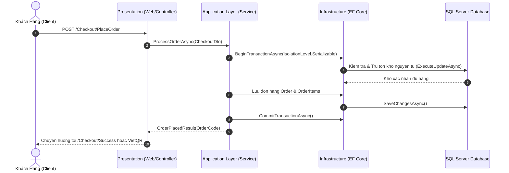

# BMAD PILLAR A: ARCHITECTURE & KIẾN TRÚC HỆ THỐNG

> **Phân hệ:** Kiến Trúc Kỹ Thuật, Luồng Xử Lý & Bảo Mật  
> **Dự án:** Perfume Luxe  
> **Mô hình:** Clean Architecture (Onion Pattern) trên .NET 8 LTS  

---

## 1. Mô Hình Phân Tầng Clean Architecture (4-Layer)

```text
┌────────────────────────────────────────────────────────────────────────┐
│                        PERFUME.WEB (Presentation)                      │
│   - MVC Controllers & Razor Views (Haute Parfumerie Luxury Theme)      │
│   - RESTful API Controllers (/api/v1/customer, /api/v1/storemanager)  │
│   - Custom Middlewares (Logging, Maintenance, Security Headers)        │
│   - Session, In-Memory Caching & Response Compression (Brotli/Gzip)    │
└───────────────────────────────────┬────────────────────────────────────┘
                                    │ Phụ thuộc (References)
┌───────────────────────────────────▼────────────────────────────────────┐
│                  PERFUME.APPLICATION (Business Contracts)              │
│   - Data Transfer Objects (DTOs) & Request/Response Models             │
│   - Service Interfaces (IPerfumeCatalogService, ICustomerCartService...)│
└───────────────────▲────────────────────────────────▲───────────────────┘
                    │                                │
┌───────────────────┴───────────────┐  ┌─────────────┴───────────────────┐
│     PERFUME.DOMAIN (Core Entities) │  │  PERFUME.INFRASTRUCTURE (Impl)  │
│ - BaseEntity (Id, Created, Delete)│  │ - PerfumeDbContext & Identity   │
│ - Product, Order, Cart, FlashSale │  │ - Catalog, Cart, Order Services  │
│ - Business Enums & Value Objects  │  │ - Schema Migrations V1 - V6     │
│ - Zero External Dependencies      │  │ - Dapper DatabaseConsoleService │
└───────────────────────────────────┘  └─────────────────────────────────┘
```

---

## 2. Luồng Xử Lý Yêu Cầu & Giao Dịch Đặt Hàng (Checkout Flow)



---

## 3. Hệ Sinh Thái REST APIs & Bảo Mật Kép (Dual Auth)

Dự án hỗ trợ song song 2 cơ chế xác thực:
1. **Cookie-based Authentication**: Dành cho giao diện storefront & trang quản trị admin trên trình duyệt (HttpOnly, SameSite, Secure).
2. **Bearer JWT Token Handler**: Dành cho REST API di động hoặc Single Page Apps (`Authorization: Bearer <token>`).

### Phân Quyền Vai Trò (Role-Based Access Control - RBAC):
- `Admin`: Toàn quyền quản trị hệ thống, báo cáo tài chính P&L, bảng điều khiển CSDL.
- `StoreManager`: Quản lý danh mục sản phẩm, duyệt đánh giá, tạo chiến dịch Flash Sale, nhập xuất kho.
- `WarehouseStaff` / `Concierge`: Quản lý đơn hàng, đổi trạng thái giao vận.
- `Customer`: Khách hàng mua sắm, tích điểm, đánh giá sản phẩm.

---

## 4. Chiến Lược Tối Ưu Hiệu Năng (Performance Strategy)

1. **Triệt tiêu hoàn toàn truy vấn N+1**:
   - Trong `CustomerCartService`, việc nạp sản phẩm cho các dòng trong giỏ được thực hiện bằng 1 câu truy vấn gom nhóm `Where(p => productIds.Contains(p.Id)).ToDictionaryAsync()`.
2. **Bộ nhớ đệm trong RAM (`IMemoryCache`)**:
   - Các bảng phân loại tĩnh ít thay đổi (`Brands`, `Categories`, `FragranceFamilies`, `FragranceNotes`) được cache trong RAM với thời gian 1 giờ, giải phóng hơn 80% tải đọc CSDL.
3. **Truy vấn chỉ đọc (`AsNoTracking`)**:
   - Toàn bộ các thao tác xem catalog, chi tiết sản phẩm, bài viết blog đều sử dụng `.AsNoTracking()` để loại bỏ chi phí theo dõi đối tượng của Change Tracker.
4. **Nén dữ liệu phản hồi (Brotli & Gzip)**:
   - Tự động nén luồng HTTP Response, giảm dung lượng truyền tải mạng xuống 70%.
