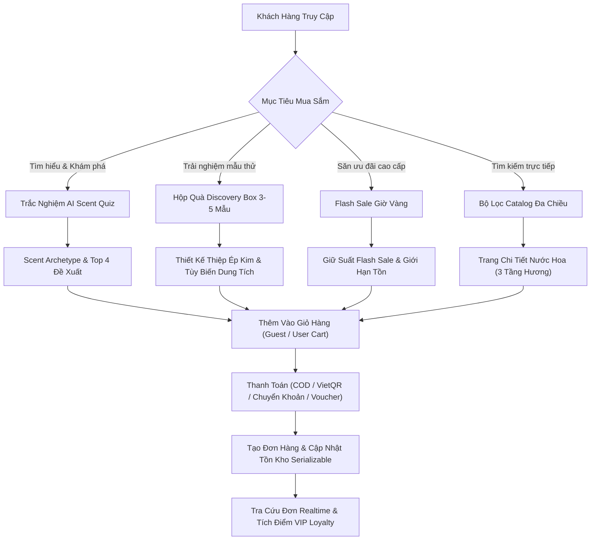

# BMAD PILLAR B: BUSINESS & NGHIỆP VỤ HỆ THỐNG

> **Phân hệ:** Nghiệp Vụ & Quy Trình Khách Hàng (Customer Journeys)  
> **Dự án:** Perfume Luxe — Haute Parfumerie & Niche Fragrances  

---

## 1. Định Vị Thương Mại & Trải Nghiệm Khách Hàng

Perfume Luxe là sàn thương mại điện tử chuyên biệt phân phối các dòng **nước hoa Niche và Haute Parfumerie cao cấp chính hãng** (Le Labo, Creed, Tom Ford, Maison Francis Kurkdjian, Byredo, Kilian...). Dự án chú trọng vào **trải nghiệm xa xỉ (Luxury Experience)** với 3 nhóm khách hàng trọng tâm:
1. **The Connoisseur (VIP / Diamond)**: Chuyên gia sưu tầm mùi hương độc bản, chuộng nồng độ Extrait de Parfum, yêu cầu giao hàng nhanh và bao bì sang trọng.
2. **The Fragrance Explorer (Silver / Gold)**: Người đam mê khám phá các nốt hương mới, thường xuyên sử dụng trắc nghiệm AI Scent Quiz và mua hộp Discovery Box (2ml/5ml) để trải nghiệm trước khi mua chai full 100ml.
3. **The Gift Giver**: Khách hàng mua quà tặng cá nhân hóa với thiệp in ép kim và các kiểu hộp quà thủ công cao cấp.

---

## 2. Luồng Trải Nghiệm Khách Hàng (Customer Journey)

---

## 3. Các Tính Năng Độc Bản (Signature Features)

### 3.1. Trắc Nghiệm Khám Phá Mùi Hương Bằng AI (AI Scent Quiz)
- Khách hàng trả lời 4 câu hỏi trực quan:
  1. Giới tính & Phong cách cá nhân (Men, Women, Unisex).
  2. Không gian & Hoàn cảnh sử dụng (Dạ tiệc, Công sở hàng ngày, Hẹn hò).
  3. Cường độ tỏa hương (Intense, Moderate, Light).
  4. Nhóm hương ưa thích (Gỗ trầm, Hoa cỏ, Cam chanh, Phương Đông).
- Thuật toán ma trận tính toán điểm phù hợp (`CalculateRawMatchScore`) chuẩn hóa thang điểm 85% - 99% và gán danh hiệu mùi hương độc bản (*The Sovereign Aristocrat*, *The Velvet Enchantress*, *The Ethereal Luminary*...).

### 3.2. Hộp Quà Trải Nghiệm Cá Nhân Hóa (Discovery Box)
- Cho phép khách chọn 3 đến 5 ống chiết VIP (dung tích 2ml hoặc 5ml).
- Tùy biến kiểu đóng gói cao cấp:
  - *Hộp Gỗ Sơn Mài Hoàng Gia* (ClassicWood - 250.000₫)
  - *Hộp Nhung Đen Huyền Bí* (RoyalVelvet - 200.000₫)
  - *Túi Da Thủ Công Viền Vàng* (ArtisanLeather - 180.000₫)
- In thiệp chúc mừng ép kim với 3 font chữ thanh lịch: *Playfair Display*, *Dancing Script*, *Cormorant Garamond*.
- Tự động tính giá theo công thức tỷ lệ thể tích và giá gốc chai fullbox.

### 3.3. Chương Trình Khách Hàng Thân Thiết VIP (Loyalty Engine)
- Tự động cộng dồn chi tiêu từ các đơn hàng giao thành công hoặc đã thanh toán:
  - **Bronze**: < 5.000.000 VNĐ (Hạng mặc định).
  - **Silver**: ≥ 5.000.000 VNĐ (Giảm giá tự động 3%).
  - **Gold**: ≥ 15.000.000 VNĐ (Giảm giá tự động 7%).
  - **Diamond**: ≥ 30.000.000 VNĐ (Giảm giá tự động 12%).
- Quy đổi điểm thưởng tích lũy: 10.000 VNĐ = 1 điểm.

### 3.4. Sự Kiện Flash Sale Giờ Vàng
- Đếm ngược thời gian thực theo giây UTC (`StartTime <= now < EndTime`).
- Quản lý hạn mức tồn kho riêng biệt (`StockLimit` và `SoldQuantity`), ngăn chặn tuyệt đối việc bán vượt số lượng.

### 3.5. Giỏ Hàng Kép (Dual Cart Architecture)
- Khách vãng lai: Sử dụng token ẩn danh mã hóa SHA-256 lưu cookie 30 ngày.
- Khi đăng nhập/đăng ký: Tự động gộp toàn bộ sản phẩm từ giỏ khách vãng lai vào tài khoản thành viên (`MergeGuestCartAsync`).

### 3.6. Tra Cứu Đơn Hàng Realtime Không Cần Đăng Nhập
- Nhập mã đơn hàng (`LUXE-YYYYMMDD-...`) và số điện thoại nhận hàng.
- Hiển thị thanh tiến trình trực quan 5 giai đoạn: *Chờ Xác Nhận → Đã Xác Nhận → Đang Vận Chuyển → Đã Giao → Hoàn Tất*.
