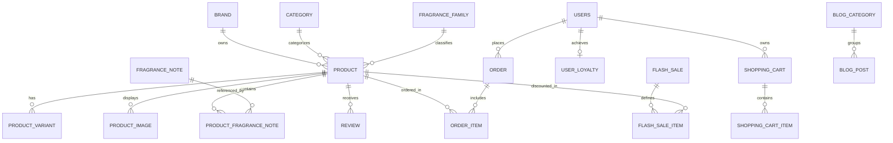

# BMAD PILLAR M: MODEL & THỰC THỂ DỮ LIỆU

> **Phân hệ:** Mô Hình Dữ Liệu & Thực Thể Domain  
> **Dự án:** Perfume Luxe  

---

## 1. Sơ Đồ Thực Thể Quan Hệ (ERD Diagram)



---

## 2. Danh Mục Thực Thể Cốt Lõi (Domain Entities)

| Thực Thể | Bảng CSDL | Các Trường Chính | Ý Nghĩa Kỹ Thuật |
|---|---|---|---|
| **`Product`** | `Products` | `Id, Name, Slug, Sku, BasePrice, Concentration, Gender, RatingAverage, IsInStock, IsFeatured, IsBestSeller, IsNewArrival` | Thông tin sản phẩm nước hoa cốt lõi, tháp hương và giá gốc. |
| **`ProductVariant`** | `ProductVariants` | `Id, ProductId, VolumeMl, VolumeLabel, OriginalPrice, SalePrice, StockQuantity, IsDefault` | Các phiên bản dung tích (10ml, 50ml, 100ml) kèm tồn kho riêng. |
| **`Brand`** | `Brands` | `Id, Name, Slug, Country, Description, LogoUrl` | Thương hiệu nước hoa (Creed, Le Labo, Tom Ford...). |
| **`Category`** | `Categories` | `Id, Name, Slug, Description` | Danh mục ngành hàng (Niche, Haute Parfumerie, Discovery...). |
| **`FragranceFamily`**| `FragranceFamilies`| `Id, Name, Slug, ColorHex, Description` | Nhóm hương chủ đạo (Woody, Oriental, Floral, Citrus, Fresh...). |
| **`FragranceNote`** | `FragranceNotes` | `Id, Name, Slug, Description` | Nốt hương chi tiết (Đàn hương, Hoắc hương, Hoa hồng Grasse...). |
| **`ProductFragranceNote`**| `ProductFragranceNotes`| `ProductId, FragranceNoteId, NoteLevel` | Quan hệ nhiều-nhiều gán nốt hương vào tầng *Top*, *Heart*, *Base*. |
| **`Order`** | `Orders` | `Id, OrderCode, CustomerName, Phone, Email, ShippingAddress, SubTotal, DiscountAmount, TotalAmount, OrderStatus, PaymentStatus` | Đơn đặt hàng của khách hàng. |
| **`OrderItem`** | `OrderItems` | `Id, OrderId, ProductId, VariantId, ProductName, VariantLabel, UnitPrice, Quantity` | Từng dòng sản phẩm cụ thể trong đơn. |
| **`ShoppingCart`** | `ShoppingCarts` | `Id, OwnerKey, UserId, ExpiresAt` | Giỏ hàng lưu trữ cho cả khách vãng lai (Cookie) và tài khoản User. |
| **`ShoppingCartItem`**| `ShoppingCartItems`| `Id, ShoppingCartId, ProductId, VariantId, Quantity, CustomUnitPrice, IsCustomBox` | Món hàng trong giỏ, hỗ trợ cả hàng lẻ và hộp quà Discovery Box. |
| **`UserLoyalty`** | `UserLoyalties` | `Id, UserId, Points, Tier, TotalSpent` | Hồ sơ tích điểm và hạng thẻ VIP của người dùng. |
| **`FlashSale`** | `FlashSales` | `Id, Name, Description, StartTime, EndTime, IsActive, BannerUrl` | Chiến dịch giảm giá giờ vàng có hạn mức thời gian. |
| **`FlashSaleItem`** | `FlashSaleItems` | `Id, FlashSaleId, ProductId, VariantId, FlashSalePrice, StockLimit, SoldQuantity` | Từng mặt hàng trong Flash Sale và hạn mức bán độc lập. |
| **`Voucher`** | `Vouchers` | `Id, Code, DiscountPercent, DiscountAmount, MinOrderAmount, MaxDiscountAmount, UsageLimit, UsedCount` | Mã giảm giá ưu đãi. |
| **`Review`** | `Reviews` | `Id, ProductId, CustomerName, Rating, Comment, ImageUrls, IsApproved` | Đánh giá & nhận xét sản phẩm. |
| **`StockAdjustment`**| `StockAdjustments`| `Id, VariantId, OldQuantity, AdjustedQuantity, NewQuantity, UnitCost, Reason, PerformedByName` | Lịch sử nhập xuất tồn kho và theo dõi giá vốn COGS. |
| **`BlogPost`** | `BlogPosts` | `Id, Title, Slug, Summary, Content, ThumbnailUrl, AuthorName, ViewCount, IsPublished, CategoryId` | Bài viết kiến thức chuyên sâu và cẩm nang mùi hương chuẩn SEO. |

---

## 3. Hệ Thống Enums

```csharp
// Nồng độ tinh dầu nước hoa
public enum Concentration { EDC = 1, EDT = 2, EDP = 3, Parfum = 4, Extrait = 5 }

// Phân khúc giới tính
public enum GenderTarget { Unisex = 1, Men = 2, Women = 3 }

// Tầng hương nước hoa
public enum NoteLevel { Top = 1, Heart = 2, Base = 3 }

// Trạng thái đơn hàng
public enum OrderStatus { Pending = 1, Confirmed = 2, Shipping = 3, Delivered = 4, Cancelled = 5 }

// Trạng thái & Phương thức thanh toán
public enum PaymentStatus { Pending = 1, Completed = 2, Failed = 3, Refunded = 4 }
public enum PaymentMethod { COD = 1, VNPAY = 2, BankTransfer = 3, MoMo = 4 }

// Phân hạng khách hàng VIP
public enum UserTier { Bronze = 1, Silver = 2, Gold = 3, Diamond = 4 }
```
