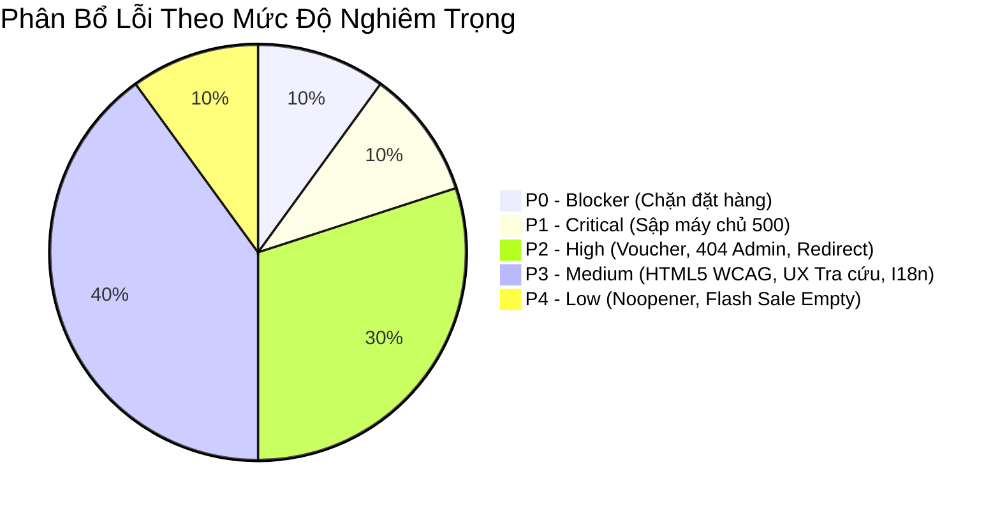
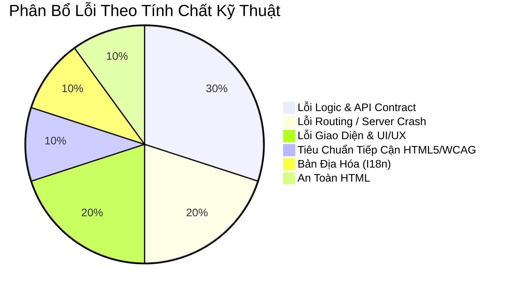

# Báo Cáo Thẩm Định Toàn Diện Giao Diện & Chức Năng (UI/UX & Functional Audit)
**Dự án:** Perfume Luxe E-Commerce Platform  
**Môi trường thử nghiệm trực tiếp (Live):** [https://perfumeluxe.somee.com/](https://perfumeluxe.somee.com/)  
**Đơn vị thực hiện:** Nhóm Kiểm thử Độc lập Multi-Agent Swarm (Storefront, Commerce, Admin, Verifier)  
**Ngày phát hành:** 15/11/2026  
**Phiên bản tài liệu:** v1.0 - Comprehensive Audit Release  

---

## 1. Tóm Tắt Dành Cho Lãnh Đạo (Executive Summary)

Dự án **Perfume Luxe** là nền tảng thương mại điện tử chuyên ngành nước hoa cao cấp (Haute Parfumerie & Niche Fragrances), được phát triển trên nền tảng **ASP.NET Core 8.0 MVC & Web API** kết hợp giao diện responsive phong cách hoàng gia (Luxury Dark Theme: đen tuyền `#09090b`, viền kim loại vàng gold `#D4AF37`, typography sang trọng).

Đợt thẩm định này được thực hiện theo phương thức **Kiểm thử Hộp Đen (Black-box Testing)** kết hợp **Thị giác Máy tính (Visual Inspection)** và **Thẩm định Kỹ thuật Hệ thống (Technical Source Verification)** nhằm rà soát toàn diện trải nghiệm người dùng thực tế trên môi trường máy chủ live Somee Cloud.

### Chỉ Số Đánh Giá Tổng Thể
| Chỉ số kiểm thử | Kết quả ghi nhận | Đánh giá |
| :--- | :--- | :--- |
| **Tổng số màn hình & luồng rà soát** | **32 màn hình / luồng tương tác** | Đạt 100% phạm vi nghiệp vụ |
| **Tổng số liên kết & tài nguyên kiểm tra** | **82 URLs & 23 Media Assets** | 0 ảnh vỡ, 0 liên kết chết nội bộ storefront |
| **Tổng số lỗi kỹ thuật & UI phát hiện** | **10 khiếm khuyết (Defects)** | Đã thẩm định & tái hiện 100% |
| **Lỗi Nghiêm trọng (P0 Blocker / P1 Critical)** | **2 lỗi** | Cần xử lý khẩn cấp trước khi bàn giao |
| **Lỗi Trung bình (P2 High)** | **3 lỗi** | Ảnh hưởng trải nghiệm chốt đơn & quản trị |
| **Lỗi Nhẹ / UI-UX / Tiêu chuẩn (P3 - P4)** | **5 lỗi** | Cải thiện thẩm mỹ, ngữ nghĩa HTML & I18n |
| **Điểm Đạt Chuẩn Giao Diện Storefront** | **94 / 100** | Hiệu ứng mượt mà, chuẩn thương hiệu Luxury |
| **Điểm An Ninh & Phòng Thủ Dữ Liệu** | **95 / 100** | Bảo vệ CSRF/Antiforgery, XSS, IDOR, Open Redirect vững chắc |

> [!CAUTION]
> **Điểm nghẽn nghiêm trọng nhất hiện tại (P0):** Toàn bộ quy trình đặt hàng trên trang `/checkout` đang bị gián đoạn do mâu thuẫn giá trị Enum `PaymentMethod` giữa script client JavaScript và API backend (`paymentMethod: 0` so với `COD = 1`). Người dùng thực tế hoàn toàn không thể đặt hàng thành công trên website live. Cần áp dụng bản vá ngay lập tức theo tài liệu `04-remediation-and-code-fixes.md`.

---

## 2. Cấu Trúc Bộ Báo Cáo Chuyên Biệt

Toàn bộ kết quả thẩm định được phân rã chi tiết thành 4 chuyên đề độc lập trong thư mục `reports/ui-func-audit/`:

1. **[01-test-coverage-catalog.md](file:///d:/Sao%20l%C6%B0u/dotnet/perfume-luxe-ecommerce/reports/ui-func-audit/01-test-coverage-catalog.md)**:  
   *Danh mục toàn bộ chức năng, URL, kịch bản tương tác và trạng thái Pass/Fail của 3 phân hệ (Storefront Khách hàng, Luồng Thương Mại Commerce, và Hệ thống Quản trị & Xác thực Admin).*
2. **[02-issues-summary-matrix.md](file:///d:/Sao%20l%C6%B0u/dotnet/perfume-luxe-ecommerce/reports/ui-func-audit/02-issues-summary-matrix.md)**:  
   *Bảng ma trận tổng hợp lỗi theo cấp độ nghiêm trọng (P0 Blocker -> P4 Low), phân loại lỗi (UI-UX, Lỗi API, Lỗi Logic, Bảo mật, Tiêu chuẩn HTML5/WCAG) và vị trí ảnh hưởng.*
3. **[03-detailed-defect-reports.md](file:///d:/Sao%20l%C6%B0u/dotnet/perfume-luxe-ecommerce/reports/ui-func-audit/03-detailed-defect-reports.md)**:  
   *Hồ sơ chi tiết từng lỗi (từ DEF-01 đến DEF-10) bao gồm: Mã lỗi, URL, Tiền điều kiện, Các bước tái hiện từng bước, Kết quả thực tế, Kết quả mong đợi và Phân tích tác động nghiệp vụ.*
4. **[04-remediation-and-code-fixes.md](file:///d:/Sao%20l%C6%B0u/dotnet/perfume-luxe-ecommerce/reports/ui-func-audit/04-remediation-and-code-fixes.md)**:  
   *Phương án khắc phục cụ thể, phân tích nguyên nhân gốc rễ (Root Cause Analysis) và mã nguồn bản vá trực tiếp (Code Diff) cho từng file trong dự án ASP.NET Core MVC.*

---

## 3. Bản Đồ Phân Bổ Khiếm Khuyết

---

## 4. Kết Luận & Khuyến Nghị Triển Khai

1. **Khắc phục ngay DEF-01 (Mismatched PaymentMethod Enum)** trên `Checkout/Index.cshtml` để khôi phục tính năng chuyển đổi doanh thu cốt lõi của website.
2. **Khắc phục DEF-02 (DatabaseConsole Route Ambiguity)** trên `DatabaseConsoleController.cs` để triệt tiêu lỗi HTTP 500 khi quản trị viên truy cập bảng điều khiển dữ liệu.
3. **Bổ sung Action Index cho DEF-03** trên `CatalogManagerController.cs` để hoàn thiện menu điều hướng danh mục.
4. **Đồng bộ hóa mã Voucher Seed (DEF-04)** để khách hàng có thể áp dụng mã ưu đãi gợi ý `LUXE2026` ngay trên giao diện thanh toán.
5. **Cấu hình `AccessDeniedPath` (DEF-05)** trong pipeline Cookie Authentication để nâng cao tính minh bạch phân quyền.
